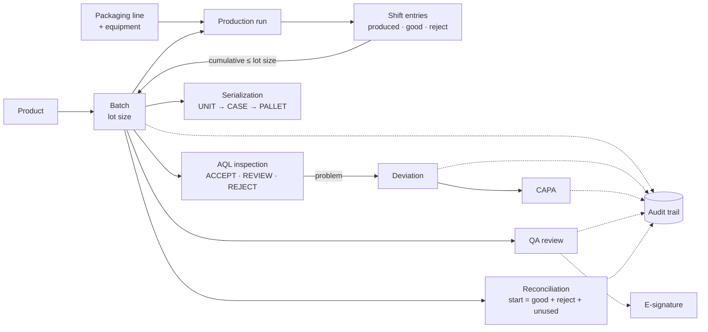

<div align="center">

# 💊 RbcTcsWorld PharmaPack QMS

### Pharmaceutical packaging Quality Management System — Spring Boot REST API with JWT, MySQL, audit trail, e-signatures, and a Cucumber / REST Assured test suite

[](https://git.io/typing-svg)

<!-- ============ STATUS BAR ============ -->
[](https://github.com/rbchy/RbcTcsWorld_PharmaPackQMS/actions/workflows/ci.yml)


</div>

---

## 📌 At a Glance

<table>
<tr>
<td width="50%" valign="top">

**🙋 What this is**

A back-end **Quality Management System for pharmaceutical packaging**. It is modelled on how a GMP blister-packaging floor really works:

- a **batch** runs on a **line**, and shift **production entries** are counted against the lot size
- **AQL** sampling decides accept / reject
- **deviations** lead to **CAPA**
- **QA reviews** release the batch, and a **material reconciliation** proves every unit is accounted for

Every create is written to an **audit trail**, decisions can carry an **electronic signature**, and every endpoint is protected by **JWT** with five roles.

Every push loads MySQL, builds the API with its **unit tests**, starts it, and runs the **Cucumber / REST Assured API suite** in GitHub Actions.

> *This is the core QMS. Its successor, [PharmaPack QMS — Serialization & Line Control](https://github.com/rbchy/RbcTcsWorld_PharmaPackQMS_Serialization), adds the React UI, the L3 serialization line and a desktop edition.*

</td>
<td width="50%" valign="top">

**📍 Quick facts**

| | |
|---|---|
| 🧩 **Modules** | 13 REST controllers, 40+ endpoints |
| 🧪 **Tests** | 28 unit · 38 Cucumber API scenarios |
| ✅ **CI** | 66 / 66 · MySQL 8 service · ≈ 2 min |
| 🔐 **Security** | JWT · BCrypt · 5 roles |
| 🧾 **Compliance** | Audit trail · e-signatures (21 CFR Part 11 concepts) |
| 📊 **Reports** | Cucumber HTML / JSON / JUnit XML · Surefire |

</td>
</tr>
</table>

---

## ✅ Latest Results

| Layer | Tests | What is asserted | Result |
|---|---:|---|---|
| 🧩 Unit (JUnit 5 + Mockito) | 28 | **Reconciliation:** balanced → `RECONCILED`; shortfall or overage → `INVESTIGATION_REQUIRED` with the exact variance; audit entry written · **AQL:** Ac/Re boundaries → ACCEPT / REVIEW / REJECT · **Production:** lot-size limit, good + reject ≤ produced, no negative quantities |  |
| 🌐 Cucumber API (REST Assured) | 38 | JWT login, wrong password and missing token → 401 · every module returns its seeded records · creates return 201 with the linked batch / product · CAPA on a fresh deviation · audit trail entry per create · AQL 3 → ACCEPT / 4 → REJECT · reconciliation variance · lot size and quantity refusals → 400 · UNIT → CASE aggregation |  |
| **Total** | **66** | | **100 %** |

<sub>GitHub Actions on Ubuntu: MySQL 8 service loaded from `database/`, Temurin 21 ([workflow](.github/workflows/ci.yml)). The Cucumber HTML report is kept as a build artifact.</sub>

---

## 🏭 Packaging Workflow



### Business rules enforced by the API

| Rule | Where it is tested |
|---|---|
| A production entry may not push a batch past its **lot size** | unit + API |
| **Good + reject** can never exceed **produced**, and no quantity may be negative | unit + API |
| Reconciliation is `RECONCILED` only when *starting = good + reject + unused*; otherwise `INVESTIGATION_REQUIRED` with the variance | unit + API |
| AQL: defects ≤ Ac → ACCEPT, ≥ Re → REJECT, between → REVIEW | unit + API |
| Every GMP-relevant create writes an audit-trail row, with user, action and entity | API |
| An e-signature needs an entity, an id and an action | API |
| Every `/api/**` call except login needs a valid JWT | API |

---

## 🧩 API Modules

| Module | Endpoints |
|---|---|
| 🔐 Auth | `POST /api/auth/login` · `GET /api/auth/me` |
| 📦 Products | `GET/POST /api/products` · `GET/PUT/DELETE /api/products/{id}` |
| 🏷️ Batches | `GET/POST /api/batches` · `GET /api/batches/{id}` · `PATCH /api/batches/{id}/status` |
| 🏗️ Master data | `GET/POST /api/master/materials` · `/equipment` · `/lines` |
| ⚙️ Production | `GET/POST /api/production/runs` · `POST /api/production/entries` · `GET /api/production/runs/{id}/entries` |
| 🔬 AQL | `GET /api/aql/plans` · `GET/POST /api/aql/inspections` |
| ⚠️ Deviations · CAPA | `GET/POST /api/deviations` · `GET/POST /api/capa` |
| ✅ QA review | `GET/POST /api/qa-reviews` |
| ⚖️ Reconciliation | `GET/POST /api/reconciliations` |
| ✍️ E-signatures | `GET/POST /api/esignatures` · `GET /api/esignatures/entity/{name}/{id}` |
| 🧾 Audit trail | `GET /api/audit-trails` · `GET /api/audit-trails/entity/{name}/{id}` |
| 🔢 Serialization | `POST /api/serialization/commission` · `POST /api/serialization/aggregate` · `GET /api/serialization/{serial}` · `/children` · `/batch/{id}` |

---

## 🛠️ Tech Stack

| Layer | Technology | Version |
|---|---|---|
| Language | Java | 21 |
| Framework | Spring Boot (Web, Data JPA, Security, Validation) | 3.5.5 |
| Security | JWT (jjwt) · BCrypt | 0.12.6 |
| Database | MySQL (scripts in `database/`) | 8 |
| Boilerplate | Lombok | — |
| Unit tests | JUnit 5 · Mockito (spring-boot-starter-test) | — |
| API tests | Cucumber · REST Assured · JUnit Platform | 7.18 · 5.5 |
| CI | GitHub Actions with a MySQL service | — |

---

## 📁 Project Structure

```
RbcTcsWorld_PharmaPackQMS/
├── .github/workflows/ci.yml       ← MySQL → build + unit tests → API → Cucumber suite
├── backend/
│   ├── src/main/java/com/pharmapack/qms/
│   │   ├── auth/                  JWT login, roles, security
│   │   ├── product/ batch/ master/ production/
│   │   ├── aql/ deviation/ capa/ qa/ reconciliation/
│   │   ├── esignature/ audit/ serialization/
│   │   └── common/                global exception handler (400 / 401 / 404)
│   └── src/test/java/             unit tests: reconciliation, AQL, production
├── automation/                    Cucumber + REST Assured suite (own pom.xml)
│   └── src/test/resources/features/   16 feature files
├── database/                      schema, seed data, phase 2 / 3 migrations, verify.sql
├── docs/                          ERD, workflow, form design, industry comparison
├── pom.xml                        backend build
└── RUNBOOK.md                     step-by-step local setup
```

---

## ⚙️ Getting Started

**Prerequisites:** JDK 21 · Maven 3.9+ · MySQL 8

```bash
git clone https://github.com/rbchy/RbcTcsWorld_PharmaPackQMS.git
cd RbcTcsWorld_PharmaPackQMS

# 1. Database
mysql -u root -p < database/schema.sql
mysql -u root -p pharmapack_qms < database/seed.sql
mysql -u root -p < database/create_app_user.sql
mysql -u root -p pharmapack_qms < database/phase2-migration.sql
mysql -u root -p pharmapack_qms < database/phase3-password-update.sql

# 2. API (unit tests run during the build)
mvn clean package
java -jar target/pharmapack-qms-0.2.0-SNAPSHOT.jar      # http://localhost:8080/api

# 3. API test suite (with the API running)
mvn -f automation/pom.xml clean test
```

You can override settings with `DB_URL`, `DB_USERNAME`, `DB_PASSWORD`, `JWT_SECRET`, `JWT_EXPIRATION_MS` and `SERVER_PORT`.

| Username | Password | Role |
|---|---|---|
| admin | admin123 | Admin |
| qa_user | qa123 | QA |
| supervisor | super123 | Supervisor |
| operator | operator123 | Operator |
| inspector | inspect123 | Inspector |

<sub>Training data only.</sub>

```bash
# log in and call a protected endpoint
TOKEN=$(curl -s -H "Content-Type: application/json" -d '{"username":"admin","password":"admin123"}' \
        http://localhost:8080/api/auth/login | jq -r .token)
curl -H "Authorization: Bearer $TOKEN" http://localhost:8080/api/batches
```

| Report | Location |
|---|---|
| Cucumber HTML | `automation/target/cucumber-reports/cucumber.html` |
| Cucumber JSON / JUnit XML | `automation/target/cucumber-reports/` |
| Unit tests | `target/surefire-reports/` |

---

## 🧹 Maintenance Log

| Change | Why |
|---|---|
| Restored `ProductionRun`, `ProductionRunRepository`, `ProductionEntryRepository` and the `aql` and `deviation` packages | **The backend did not compile.** `ProductionController`, `CapaController` and the AQL / deviation features used these classes, but they were never committed |
| Added `sumProducedByBatchId` | The lot-size check in `ProductionController` called a repository method that did not exist |
| Real unit tests for reconciliation, AQL and production (28) | The only unit test did BigDecimal sums inside the test and never called the application |
| *"the QMS API is running"* asserts HTTP 200 · list endpoints check their seeded records | The checks only asserted *status 200 and JSON* |
| New API scenarios: AQL 3 / 4 defects, reconciliation variance, lot-size overrun, good + reject > produced | Only the happy path of each calculation was tested |
| Cucumber HTML / JSON / JUnit reports | The runner produced no report |
| Removed `*.bak` / `*.before-clean` sources, compiled classes in `bin/`, and an empty root `package-lock.json` | Leftovers, not part of the build |
| GitHub Actions with a MySQL 8 service | There was no CI; the README listed Jenkins as planned |
| README describes only what exists | It listed a `frontend/` folder, React forms and Selenium UI tests, none of which are in this repo. Those live in the [Serialization edition](https://github.com/rbchy/RbcTcsWorld_PharmaPackQMS_Serialization) |

---

## 📈 Roadmap

- [x] Compiling backend, real unit and API tests, GitHub Actions
- [ ] Role-based authorization tests (e.g. an OPERATOR cannot approve a QA review)
- [ ] Batch status life cycle tests (`PATCH /api/batches/{id}/status`)
- [ ] Testcontainers MySQL for repository-level tests
- [ ] Allure reporting
- [x] React UI, serialization line and desktop edition: see [PharmaPack QMS — Serialization & Line Control](https://github.com/rbchy/RbcTcsWorld_PharmaPackQMS_Serialization)

---

## 🔗 Related Projects

| Project | Stack |
|---|---|
| 💊 [PharmaPack QMS — Serialization & Line Control](https://github.com/rbchy/RbcTcsWorld_PharmaPackQMS_Serialization) | Successor: React UI · L3 serialization · PLC simulator · 77 / 77 in CI · Allure on Pages |
| ⭐ [RbcTcsWorld E-Commerce Suite](https://github.com/rbchy/RbcTcsWorld_ECommerceSuite) | Spring Boot · REST Assured · Selenium · Playwright · CI quality gates |
| 🧬 [RbcTcsWorld ClinTrial Connect](https://github.com/rbchy/RbcTcsWorld_ClinTrial-Connect) | Clinical-trial platform with its own test suite |
| 🏥 [OpenEMR Healthcare](https://github.com/rbchy/OpenEMR_Automation) | Java · Selenium · Cucumber · TestNG, CI green |

<sub>All projects: [github.com/rbchy](https://github.com/rbchy)</sub>

---

## ⚠️ Disclaimer

This is a **portfolio / training project**. It is built from hands-on GMP packaging experience and publicly documented industry concepts. It is **not** a validated GxP system.

A real deployment would need:

- computer-system validation (IQ/OQ/PQ)
- change control and data-integrity controls
- a security review
- alignment with site SOPs

All credentials and secrets in this repository are demo values.

---

## 👤 Author

<div align="center">

**Ranajit Baran Chowdhury (RB Chowdhury)**
QA Automation Engineer / SDET · Pharmaceutical Packaging Production (GMP) · West Norriton, Pennsylvania, USA

[](https://www.linkedin.com/in/rbchy/)
[](https://github.com/rbchy)
[](https://rbchy.github.io/rbchy/)
[](https://rbc6543.wixsite.com/rbc-portfolio)
[](mailto:chyranajit@gmail.com)

⭐ *If this project helps you, a star on the repo is appreciated.*

</div>
